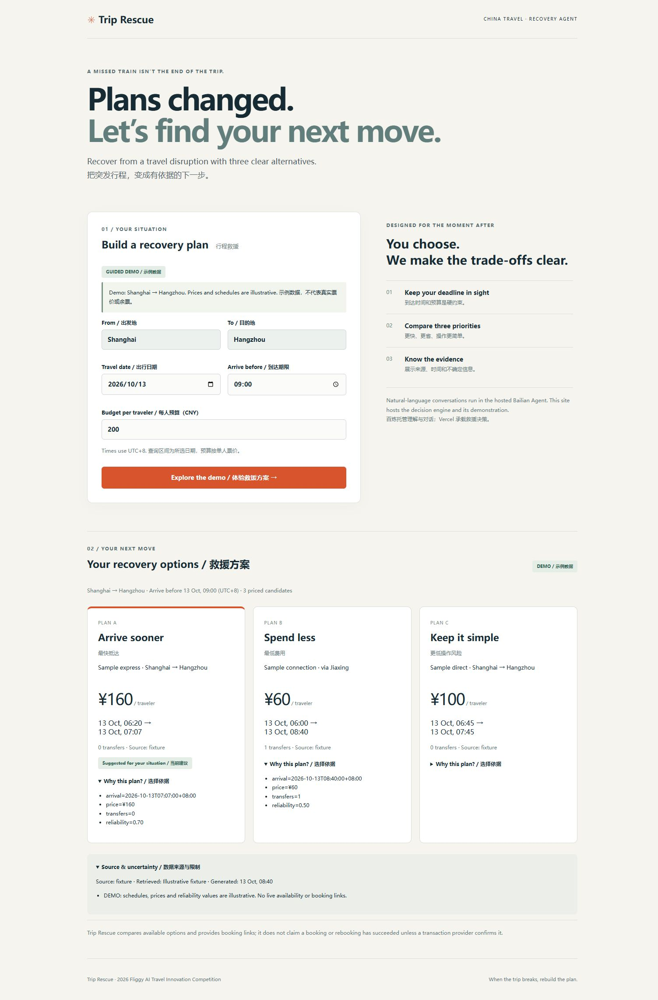

## 参赛项目名称

Trip Rescue — 行程中断救援助手

## 团队 / 作者与奖品领取人

- 团队名称：Licecert
- 主要提交人 GitHub ID（仅 1 位）：Licecert

## 旅行场景与目标用户

旅客错过车次、遭遇延误或接驳失败后，需要在到达期限和每人预算内决定下一步。Trip Rescue 面向中国境内旅行者，也支持入境旅客的语言和出行需求；不根据英语或目的地猜测身份。

## 我做了什么

将行程中断转化为可比较的行动选择：解析用户约束，通过飞猪获取真实交通候选，再由确定性决策服务筛选与排序，输出最快抵达、最低费用、更低操作风险三种方案。

在供应商本次实际返回的完整候选中，最快比较满足约束后的到达时间，最便宜比较可行候选的每人票价；没有可验证方案时明确说明。搜索排序、返回数量和库存变化会影响候选覆盖，不保证全网最优；不同目标可以选中同一方案。供应商数据、查询时间、限制和预订入口随结果保留。推荐不代表付款、预订成功或安全保证。

## 百炼使用说明（必填）

- 百炼能力 / 模型：Managed Agent，Qwen3.7-Max，Skill 和 MCP 工具编排。
- 调用方式：百炼托管会话；飞猪 Skill 云端调用；鉴权 HTTPS/SSE MCP 决策工具。
- 使用环节与输入输出：百炼在运行时理解中断事件及约束，查询真实交通并调用决策工具，将结构化方案解释为中文或英文。
- Skill 名称：飞猪旅行。
- 其他工具 / 技术栈：TypeScript、Next.js、React、MCP SDK、Vercel、阿里云函数计算基础模式。服务鉴权使用 Token，不依赖浏览器 Cookie。

## 效果展示

以下是已部署网站的实际运行界面，使用明确标注的固定样例数据，展示三方案比较；不是实时查票截图。

## 项目链接与复现方式

- 代码仓库：https://github.com/Licecert/trip-rescue-competition
- 在线界面演示：https://trip-rescue-weld.vercel.app/
- 本地复现：Node.js 22，`npm ci` 后执行 `npm run dev`，打开 http://localhost:3000 。完整运行与工具接入方式见 README。

**两种体验的边界：**

| 入口 | 数据和用途 | 调用及费用 |
| --- | --- | --- |
| 在线界面演示 | 固定样例，用于体验界面、三方案和预算/时间筛选，不代表余票或实际报价 | 正常页面交互不调用飞猪、百炼模型或阿里云 FC，不消耗飞猪 API 额度；会使用 Vercel 托管与决策接口 |
| 百炼真实智能体 | 正式飞猪凭据查询交通，然后调用决策工具，保留真实查询时间和警告 | 消耗飞猪查询额度与模型 Token，可能产生 FC/沙箱费用；后台会话需账号权限，不作为免登录公共入口 |

真实调用需使用自己的百炼账号和正式飞猪凭据。Key、Token 不在公开仓库和参赛说明中。此公开代码可复现界面和决策工具；不包含作者账号凭据、托管会话或私人运行记录。
